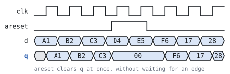

# 16.7 bug_async_reset

**New concept:** debugging a register with reset.

This file is a complete design that compiles, but it has a bug. The task below says what
the design is **supposed** to do. Find the bug with the grader and the waveform, and fix
it, changing as little as possible.

**Coming from Verilog:** Bugs like this one exist in Verilog too; the VHDL symptoms are what's worth learning to recognize.

## Task

8 flip-flops `q` loading `d` at each rising edge, with an active-high **asynchronous** reset `areset` to `x"00"`.



## Ports

```vhdl
entity top_module is
  port (
    clk, areset : in  std_logic;
    d           : in  std_logic_vector(7 downto 0);
    q           : out std_logic_vector(7 downto 0)
  );
end entity top_module;
```

## Hints

<details><summary>Hint 1</summary>

`areset` is in the sensitivity list, but what does the process do when it wakes up because of `areset` alone?

</details>

## Check

```
./check.py 16.7
```
