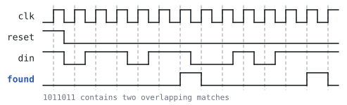

# 16.8 bug_fsm_default

**New concept:** debugging a two-process FSM.

This file is a complete design that compiles, but it has a bug. The task below says what
the design is **supposed** to do. Find the bug with the grader and the waveform, and fix
it, changing as little as possible.

**Coming from Verilog:** Bugs like this one exist in Verilog too; the VHDL symptoms are what's worth learning to recognize.

## Task

`din` is sampled at each rising edge. `found` is `'1'` during the cycle after the
edge at which the last four samples were `1, 0, 1, 1` (oldest first); overlapping
matches count. Active-high synchronous `reset` forgets everything received so far.



## Ports

```vhdl
entity top_module is
  port (
    clk, reset, din : in  std_logic;
    found           : out std_logic
  );
end entity top_module;
```

## Hints

<details><summary>Hint 1</summary>

In `S_NONE` with `din = '0'`, what does `next_state` become?

</details>

## Check

```
./check.py 16.8
```
