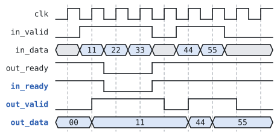

# 16.12 bug_handshake

**New concept:** debugging a valid/ready buffer.

This file is a complete design that compiles, but it has a bug. The task below says what
the design is **supposed** to do. Find the bug with the grader and the waveform, and fix
it, changing as little as possible.

**Coming from Verilog:** Bugs like this one exist in Verilog too; the VHDL symptoms are what's worth learning to recognize.

## Task

One-entry valid/ready buffer (as in 11.8):

- `out_valid = '1'` whenever the buffer holds an entry, shown on `out_data`
- `in_ready = '1'` when the buffer is empty **or** `out_ready = '1'`
- at a rising edge, the entry leaves if `out_valid` and `out_ready` are `'1'`, and
  `in_data` is stored if `in_valid` and `in_ready` are `'1'` (both may happen)
- `out_data` keeps the last stored value while empty

Active-high synchronous `reset` → empty, `out_data = x"00"`.



## Ports

```vhdl
entity top_module is
  port (
    clk, reset, in_valid, out_ready : in  std_logic;
    in_data                         : in  std_logic_vector(7 downto 0);
    in_ready, out_valid             : out std_logic;
    out_data                        : out std_logic_vector(7 downto 0)
  );
end entity top_module;
```

## Hints

<details><summary>Hint 1</summary>

With a consumer that is always ready, how many cycles does each byte take?

</details>

## Check

```
./check.py 16.12
```
