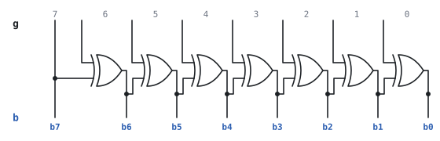

# 16.13 bug_gray_loop

**New concept:** debugging a loop.

This file is a complete design that compiles, but it has a bug. The task below says what
the design is **supposed** to do. Find the bug with the grader and the waveform, and fix
it, changing as little as possible.

**Coming from Verilog:** Bugs like this one exist in Verilog too; the VHDL symptoms are what's worth learning to recognize.

## Task

Gray code to binary: `b(7) = g(7)`, and `b(i) = b(i+1) XOR g(i)` for lower bits.



## Ports

```vhdl
entity top_module is
  port (
    g : in  std_logic_vector(7 downto 0);
    b : out std_logic_vector(7 downto 0)
  );
end entity top_module;
```

## Hints

<details><summary>Hint 1</summary>

Which bit should the running XOR start from?

</details>

## Check

```
./check.py 16.13
```
