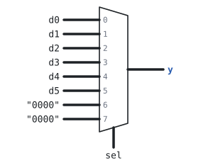

# 16.14 bug_case_others

**New concept:** debugging a mux.

This file is a complete design that compiles, but it has a bug. The task below says what
the design is **supposed** to do. Find the bug with the grader and the waveform, and fix
it, changing as little as possible.

**Coming from Verilog:** Bugs like this one exist in Verilog too; the VHDL symptoms are what's worth learning to recognize.

## Task

A 6-to-1 mux of 4-bit inputs: `sel` 0–5 selects `d0`–`d5`; `sel` 6 or 7 outputs `"0000"`. (There are two bugs in this one.)



## Ports

```vhdl
entity top_module is
  port (
    sel                    : in  std_logic_vector(2 downto 0);
    d0, d1, d2, d3, d4, d5 : in  std_logic_vector(3 downto 0);
    y                      : out std_logic_vector(3 downto 0)
  );
end entity top_module;
```

## Hints

<details><summary>Hint 1</summary>

Read every choice against the task. Then ask what `y` is when `sel = "110"`.

</details>

## Check

```
./check.py 16.14
```
